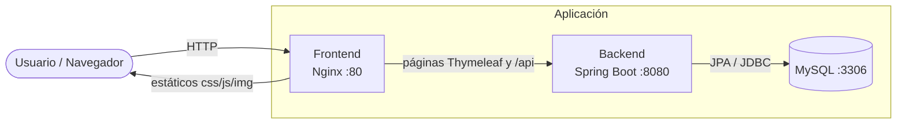
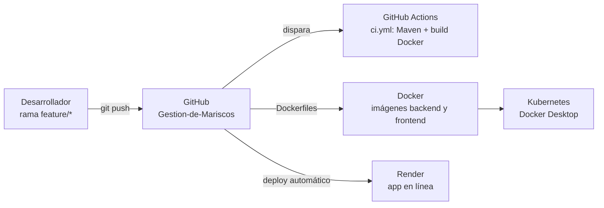
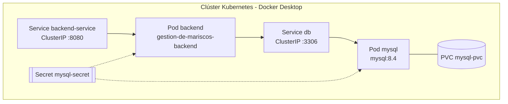

# Arquitectura – Rinconcito Marino

Responsable: Alex · rama `feature/alex`

## 1. Componentes

| Componente | Tecnología | Puerto | Función |
|------------|------------|--------|---------|
| Frontend | Nginx 1.30 (alpine) | 80 (3000 en local) | Sirve `css/`, `js/`, `img/`, `icons/` y reenvía páginas y `/api` al backend |
| Backend | Spring Boot 3.5 + Java 21 (Thymeleaf, JPA, Security) | 8080 | Páginas Thymeleaf y API REST (`/api/productos`, pedidos, contacto) |
| Base de datos | MySQL 8 (H2 en memoria si no se configura) | 3306 | Productos, pedidos, usuarios, mensajes de contacto |

## 2. Diagrama general

## 3. Del código al despliegue

## 4. Vista en Kubernetes (Docker Desktop)

Archivos: `k8s/deployment.yaml` (PVC + Deployments `mysql` y `backend`) y `k8s/service.yaml` (Services `db` y `backend-service`).

> Pendiente de confirmar con el equipo: agregar el frontend (Deployment + Service) a `k8s/` si se quiere desplegar también Nginx en el clúster.
