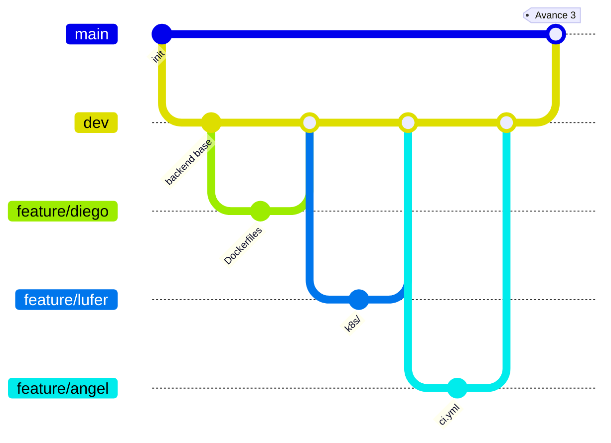

# Git y GitHub – Rinconcito Marino

Responsable: Alex · rama `feature/alex`

Repositorio: <https://github.com/AngelHuaman13/Gestion-de-Mariscos>

## 1. Estrategia de ramas

Se trabaja con un flujo tipo **Git Flow simplificado**: cada integrante desarrolla en su propia rama, integra en `dev` y, cuando `dev` está estable, se pasa a `main`.

| Rama | Uso | Responsable |
|------|-----|-------------|
| `main` | Versión estable / entregable | Todo el equipo (vía Pull Request) |
| `dev` | Integración de las ramas de cada integrante | Todo el equipo |
| `feature/alex` | Documentación (Git, despliegue, arquitectura) | Alex |
| `feature/lufer` | Kubernetes (`k8s/`) | Luis Fernando Sotelo |
| `feature/diego` | Docker (Dockerfile del front y del back) | Diego |
| `feature/ashi` | Pruebas en Docker Desktop + Kubernetes | Eidan (Ashi-Games) |
| `feature/angel` | GitHub Actions (`ci.yml`) y README final | Angel |



## 2. Flujo de trabajo de cada integrante

```bash
# 1. Clonar (solo la primera vez)
git clone https://github.com/AngelHuaman13/Gestion-de-Mariscos.git
cd Gestion-de-Mariscos

# 2. Ir a mi rama y traer lo último de dev
git checkout feature/alex
git pull origin dev

# 3. Trabajar, revisar y guardar cambios
git status
git add docs/
git commit -m "Docs: documentacion de Git y diagrama de arquitectura"

# 4. Subir mi rama
git push origin feature/alex

# 5. Integrar en dev
git checkout dev
git pull origin dev
git merge feature/alex
git push origin dev
```

Para pasar de `dev` a `main` se abre un **Pull Request** en GitHub (`dev → main`), se revisa y se aprueba.

## 3. Convención de commits

Mensajes cortos, en español y con prefijo del área:

| Prefijo | Ejemplo real del repo |
|---------|-----------------------|
| `Docker:` | `Docker: Dockerfile del frontend (Nginx) y mejoras al del backend` |
| `K8s` | `K8s Despliegue de backend y MySQL` |
| `Accion N:` | `Accion 4: matriz con os y version` |
| `feat:` / `fix:` | `fix: contenido del workflow accion 5` |
| `Docs:` | `Docs: documentacion de Git y diagrama de arquitectura` |

## 4. Resolución de conflictos

1. `git pull origin dev` dentro de la rama propia antes de hacer merge.
2. Si aparece un conflicto, Git marca el archivo con `<<<<<<<`, `=======` y `>>>>>>>`.
3. Se deja el código correcto, se borran las marcas y se confirma:

```bash
git add <archivo>
git commit -m "Resuelve conflicto con dev"
```

Ejemplo real: se renombró el compose a `docker-compose.mariscos.yaml` para no chocar con el `docker-compose.yaml` que ya existía en `dev`.

## 5. Archivos que no se suben

El `.gitignore` del backend excluye `target/` (el `.jar` compilado). Las imágenes Docker no se versionan: se construyen con los Dockerfiles del repo.

## 6. Integración con GitHub Actions

El workflow `ci.yml` se ejecuta en cada `push` a `main`, `dev` y `feature/**`, y en cada Pull Request a `main`/`dev` (detalle en la documentación de GitHub Actions). Así, antes de integrar, se verifica que el backend compile con Maven y que las imágenes Docker se construyan.
